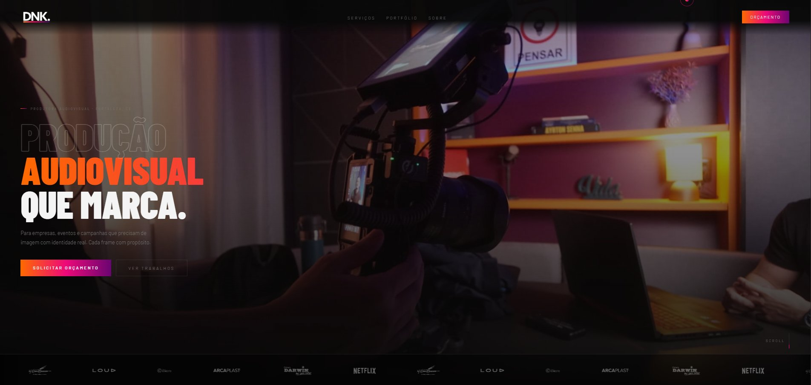
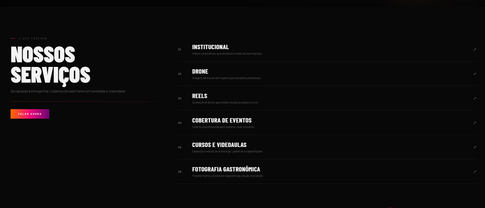
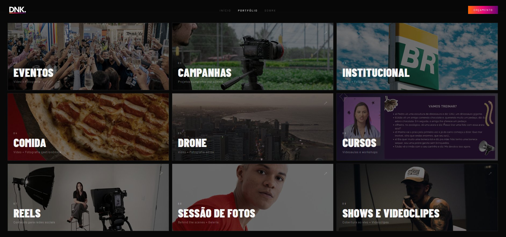
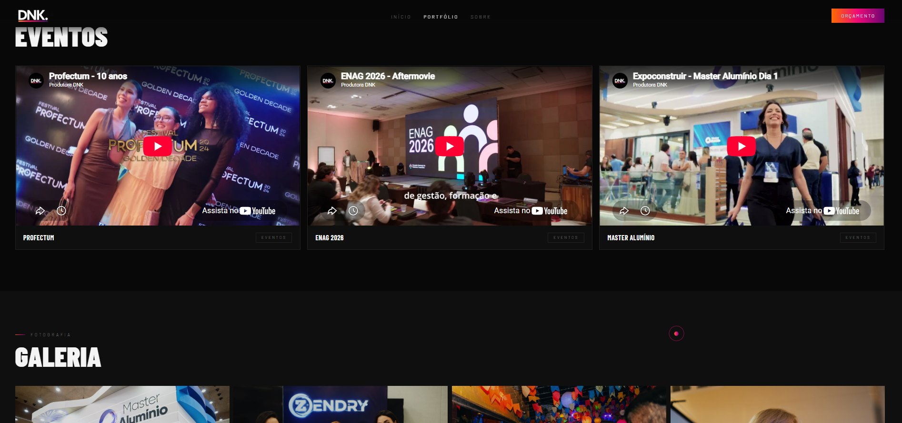
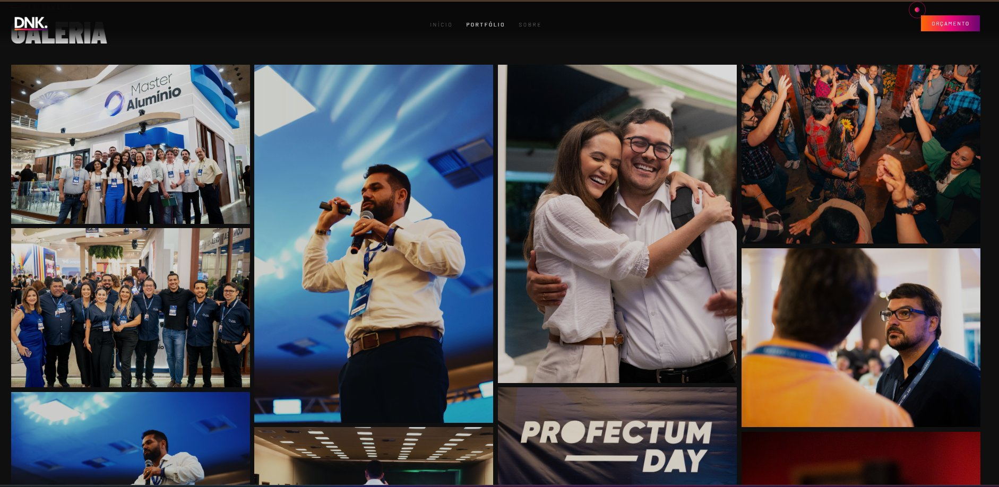

# Site DNK Produtora

Site institucional da [DNK Produtora Audiovisual](https://produtoradnk.com), produtora de Fortaleza/CE. Desenvolvido em HTML, CSS e JavaScript puros, leve e responsivo, e hoje um dos principais canais de aquisição de clientes da empresa.

🔗 **[produtoradnk.com](https://produtoradnk.com)**

## Destaques

- **14 páginas**, incluindo o portfólio dividido por categoria
- **Portfólio integrado ao YouTube:** os vídeos são exibidos direto do canal da produtora, sem pesar a hospedagem
- **Galeria de fotografia** em layout de mosaico
- **Botão de contato direto para o WhatsApp**
- **Leve e responsivo:** sem frameworks, carrega rápido e funciona bem no celular
- **Gerando resultado:** o site é o destino das campanhas no Google Ads e tem trazido novos clientes para a produtora

## Páginas

**Serviços**

**Portfólio por categoria**

**Vídeos integrados ao YouTube**

**Galeria de fotografia**

## Infraestrutura

Além do desenvolvimento, toda a configuração de publicação foi feita por mim:

- **Hospedagem:** Hostinger
- **DNS:** gerenciado no painel da Wix, apontando para o servidor da Hostinger
- **E-mail do domínio:** configuração de autenticação com DMARC e acompanhamento dos relatórios

## Stack

| Camada | Tecnologia |
|---|---|
| Frontend | HTML, CSS, JavaScript |
| Vídeos | YouTube (embed) |
| Hospedagem | Hostinger |
| DNS | Wix |
| Aquisição | Google Ads |

## Desenvolvimento

Desenvolvido por Bruno Bezerra de Matos com apoio do Claude (Anthropic).
